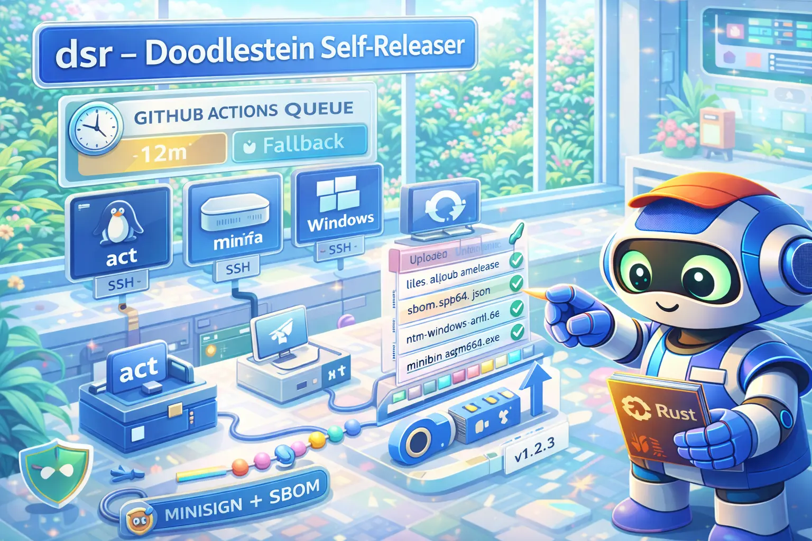

# dsr — Doodlestein Self-Releaser

<div align="center">
  
</div>

<div align="center">

**Fallback release infrastructure for when GitHub Actions is throttled.**

[](./LICENSE)
[](https://www.gnu.org/software/bash/)

</div>

<div align="center">
<h3>Quick Install</h3>

```bash
curl -fsSL "https://raw.githubusercontent.com/Dicklesworthstone/doodlestein_self_releaser/main/install.sh?$(date +%s)" | bash
```

</div>

When GitHub Actions queue times exceed 10 minutes, `dsr` takes over — reusing your existing workflow YAML to build locally via [nektos/act](https://github.com/nektos/act), then uploads artifacts to GitHub Releases.

---

## TL;DR

**The Problem**: GitHub Actions gets throttled during peak times. Your release sits in queue for 20+ minutes while users wait.

**The Solution**: `dsr` detects throttling, builds locally using your existing workflow files, and uploads to GitHub Releases — same artifacts, no queue.

### Why Use dsr?

| Feature | What It Does |
|---------|--------------|
| **Zero config builds** | Reuses your `.github/workflows/release.yml` — no parallel build system to maintain |
| **Multi-platform** | Builds on Linux (act), macOS (native), Windows (native) via SSH |
| **Signed releases** | Minisign signatures + SBOM generation built in |
| **Queue detection** | Monitors GH Actions queue time, triggers fallback automatically |

---

## Quick Example

```bash
# Check if any repos are throttled
$ dsr check --all
Checking ntm... queued 12m (threshold: 10m) ⚠️
Checking bv... ok ✓
Checking cass... ok ✓

# Build locally when throttled
$ dsr build --repo ntm --version v1.2.3
Building ntm v1.2.3 for linux/amd64, darwin/arm64, windows/amd64...
  linux/amd64   [act on linux-builder]     ✓ 45s
  darwin/arm64  [native on mac-builder] ✓ 32s
  windows/amd64 [native on win-builder]  ✓ 51s
Artifacts: /tmp/dsr/artifacts/ntm-v1.2.3/

# Upload to GitHub Release
$ dsr release --repo ntm --version v1.2.3
Uploading 6 assets to ntm v1.2.3...
  ntm-linux-amd64           ✓
  ntm-linux-amd64.minisig   ✓
  ntm-darwin-arm64          ✓
  ntm-darwin-arm64.minisig  ✓
  ntm-windows-amd64.exe     ✓
  ntm-windows-amd64.exe.minisig ✓
Release: https://github.com/Dicklesworthstone/ntm/releases/tag/v1.2.3

# Or do it all in one command
$ dsr fallback --repo ntm --version v1.2.3
```

---

## Design Philosophy

1. **Reuse, don't reinvent** — Your GitHub Actions workflow is the source of truth. `dsr` runs it locally via `act`, not a parallel build system.

2. **Detect, don't guess** — Queue time monitoring tells you exactly when to fall back. No manual threshold tuning.

3. **Same artifacts, different path** — Users get identical binaries whether built by GH Actions or `dsr`.

4. **Fail loudly, recover gracefully** — Structured exit codes (0-8) and JSON output for scripting. Partial failures are reported, not hidden.

5. **Local-first, cloud-optional** — Works offline. SSH to your Mac Mini and Windows laptop for native builds.

---

## Comparison

| Feature | dsr | Manual builds | GoReleaser | GitHub-hosted runners |
|---------|-----|---------------|------------|----------------------|
| Uses existing workflow | ✅ | ❌ | ❌ Config needed | ✅ |
| Multi-platform builds | ✅ Linux/macOS/Windows | Manual | ✅ | ✅ |
| Queue detection | ✅ Automatic | ❌ | ❌ | N/A |
| Signing | ✅ Minisign | Manual | ✅ GPG/cosign | ✅ |
| SBOM generation | ✅ syft | Manual | ✅ | ✅ |
| Cost | Free | Free | Free | $$/min |

**When to use dsr:**
- You have existing GH Actions release workflows
- You want a fallback for throttled queues
- You have SSH access to macOS/Windows machines for native builds

**When dsr might not be ideal:**
- You don't use GitHub Actions
- You need builds on platforms you don't have machines for
- You want a full CI/CD replacement (dsr is a fallback, not a replacement)

---

## Installation

### From Source

```bash
git clone https://github.com/Dicklesworthstone/doodlestein_self_releaser.git
cd doodlestein_self_releaser
chmod +x dsr
sudo ln -s "$(pwd)/dsr" /usr/local/bin/dsr
```

### Dependencies

Required:
- **Bash 4.0+** (macOS ships with 3.x — `brew install bash`)
- **git** — Version control
- **gh** — GitHub CLI for API access
- **jq** — JSON parsing
- **yq (mikefarah v4)** — Read and safely edit YAML configuration

For local builds:
- **docker** — Required for nektos/act containers
- **act** — `brew install act` or [nektos/act releases](https://github.com/nektos/act/releases)

> **CRITICAL: act Configuration Required**
>
> The default act runner images (catthehacker/ubuntu) run as UID 1001. If you use `--bind` in your `~/.actrc` without proper user mapping, **files created by act will have wrong ownership**, breaking access for other processes.
>
> After installing act, copy the example config:
> ```bash
> cp config/actrc.example ~/.actrc
> ```
>
> Or add this line to your `~/.actrc` (replace 1000:1000 with your UID:GID from `id`):
> ```
> --container-options --user=1000:1000
> ```
>
> Run `dsr doctor` to verify your configuration.
>
> See [docs/ACT_SETUP.md](docs/ACT_SETUP.md) for complete setup instructions.

For multi-platform builds:
- **ssh** — Access to macOS/Windows build machines

For signing:
- **minisign** — `brew install minisign`
- **syft** — For SBOM generation

### Verify Installation

```bash
dsr doctor
```

---

## Quick Start

### 1. Initialize Configuration

```bash
dsr config init
```

This creates `~/.config/dsr/config.yaml` with defaults.

### 2. Add Repositories

```bash
dsr repos add Dicklesworthstone/ntm --local-path /data/projects/ntm --language go
```

### 3. Configure Build Hosts (Optional)

Edit `~/.config/dsr/hosts.yaml`:

```yaml
hosts:
  linux-builder:
    platform: linux/amd64
    connection: local
  mac-builder:
    platform: darwin/arm64
    connection: ssh
    ssh_host: mac-builder
  linux-builder-2:
    platform: linux/amd64
    connection: ssh
    ssh_host: linux-builder-2
    build_root: /var/tmp/dsr-builds   # optional: disk-backed staging root
  win-builder:
    platform: windows/amd64
    connection: ssh
    ssh_host: win-builder
```

Ensure hosts have required toolchains for your repos (rust/go/bun) and that `linux-builder` has Docker + act for Linux builds.

Native host selection checks the toolchain used by a plain `cargo`, `go`, `bun`,
or `node` build command. Rust readiness requires both Cargo and rustc to run
successfully. The same requirement applies before source transfer and again
before compilation, including explicitly pinned hosts. Recipes that select an
executable path, wrapper, or nondefault toolchain keep their existing build
context checks instead of being judged against an unrelated ambient compiler.

Unix source synchronization preserves file contents, permissions and links,
while newly transferred files belong to the account receiving the build over
SSH. This also applies to root workers and the tar fallback, so a macOS
controller's numeric UID is not imported into a Linux checkout. An existing
destination or `.git` entry owned by another account stops synchronization
with the path and both UIDs in the error. Select a fresh build stage or repair
that checkout's ownership before retrying; DSR does not add Git
`safe.directory` exceptions or change ownership of existing projects.

Release snapshots and isolated Rust builds are staged under `/var/tmp` on Linux hosts and
`/private/tmp` on macOS — never `/tmp`, which is frequently a RAM-backed tmpfs that a multi-GB
source tree plus Cargo target will exhaust. Set `build_root` on a host to stage somewhere else
(a bigger disk, or a host whose `/var/tmp` is also RAM-backed); `DSR_STRICT_BUILD_ROOT` still
overrides it for strict release snapshots. Either way dsr refuses to stage onto a tmpfs/ramfs
root and tells you to set `build_root`.

Every new Unix strict snapshot has a `.sbh-protect` marker in its private run
directory before source extraction. The marker protects the source archives,
private Cargo caches, and compiler outputs from SBH cleanup, including emergency
cleanup. It sits outside the authenticated source tree and remains with the
retained snapshot.

Strict snapshots must also live on a filesystem that preserves POSIX file modes. ExFAT, FAT
and some FUSE/SMB mounts report every file as executable, so a tracked `100644` file can no
longer be distinguished from a `100755` one. dsr verifies each extracted snapshot (bytes,
modes, links and the exact node count) immediately after transfer, before any target compiles,
and names the first offending path, its Git mode, the observed mode and the backing filesystem.
On a Mac whose only large disk is an external ExFAT drive, create an APFS disk image on it
(`hdiutil create -size 200g -fs APFS -volname dsr-builds /Volumes/External/dsr-builds.sparseimage
-type SPARSE`), attach it, and point `build_root` at the mounted volume.

Set `DSR_KEEP_BUILD_STAGES=1` to retain isolated Rust source and Cargo-home staging
directories after a native build, including failed or cancelled builds. This is
useful for inspecting a build or when automatic deletion is prohibited. Retained
stages consume disk space; the build log records their paths. Source isolation,
artifact collection, and verification run normally.

Native Unix builds require Python 3.9+ on the build host. A host-side supervisor
owns a separate process group and enforces the build deadline, including when
the SSH connection closes or the supervisor is killed or stopped. Completion
also retires lingering children, with a short graceful shutdown before forced
termination. Build output passes through unchanged. This contains normal child
processes; trusted build commands that deliberately create a separate session
can escape the group. Strict Rust builds retain their Python 3.11+ requirement.

Ordinary native Rust builds also give every attempt a fresh final output
directory. A configured absolute `CARGO_TARGET_DIR` names the base directory;
DSR builds and collects from a unique child beneath it. This applies to single
targets as well as target matrices, so a successful command that produces no
new binary cannot publish an older binary from a shared target directory.
Dependency-cache reuse is unchanged, and prior attempt outputs are retained.

Strict native source snapshots include initialized project submodules and their
nested submodules at the commits recorded by their parent Git trees. Initialize
the checkout with `git submodule update --init --recursive` before building.
DSR reads and authenticates the selected commit, tree and blob objects directly;
submodule URLs and mutable child HEADs cannot select release bytes. Missing
pinned objects, external Git object stores and unsafe administration pointers
are refused without fetching. Ordinary absorbed submodules and self-contained
child repositories are supported. The coordinator needs Python 3.9+ for these
recursive exports.

Each native snapshot retains a deterministic archive and its complete Git
manifest for independent staging, collection and recovery checks. Unix keeps
safe tracked links; Windows materializes safe file links as regular copies.
A link must stay inside its own repository, including during `..` traversal.
Both receivers reject changed submodule bytes and unlisted files. Each archive
is bounded to 16 nested levels, 256 repositories and 100,000 Git tree entries.

Strict native Rust builds seed private Cargo homes with downloads selected
by the committed `Cargo.lock`: checksum-matching crate archives, their index
records, and Git databases containing locked commits. Ambient extracted registry
sources and ordinary Git checkouts are never copied; Cargo recreates them offline
from the selected downloads. A locked Git commit containing submodules also
retains its matching checkout and self-contained nested Git stores, so Cargo can
resolve those submodules offline. The checkout must have the exact locked HEAD;
each nested commit and its source bytes are then authenticated against the
gitlink in its parent before the seed is admitted. Unrelated cached links,
special files, and large archives
do not enter the seed, and an unused Git cache on another volume is not opened.
Selection covers the complete lockfile, including other targets and features;
selected Git databases and legacy registry Git indexes retain their history.
It is not a minimal target graph. Strict Unix hosts require Python 3.11+;
strict Windows hosts require PowerShell 7.4+ and a local NTFS Cargo cache. Configuration,
credentials, symlinks, Windows reparse points, and external Git storage
pointers are excluded or refused. The first successful locked, offline metadata
resolution publishes a retained seed alongside the source snapshot. If that
first resolution lacks dependencies, no seed is published: refill the ambient
cache and retry. Once admitted, the seed survives deletion or in-place changes
to the ambient cache, and every metadata invocation and target attempt receives
a fresh copy. Retained seeds contain the selected downloads and any required
submodule checkouts; ordinary sources unpacked during metadata do not enter the
seed. Retries must match the seed's original lockfile
selection and inventory. The selected lockfile hash must agree with the lockfile used
to authenticate dependency sources. Parallel targets therefore do not share
writable dependency files.

Before a strict native seed is admitted, DSR authenticates the resolved
dependency source files against the committed `Cargo.lock`. Registry archives
must have their locked SHA-256 checksums, and their extracted files must match
those archives. Git checkouts must match the locked commit's actual objects.
This covers the all-features graph from every workspace member on both Unix
and Windows. Nested Git submodules use the parent's authenticated gitlink as
their commit authority, independently of a mutable child HEAD or URL. Missing,
modified or substituted submodule sources and external Git administration
pointers are refused. Windows dependency sources still refuse symlinks and
reparse points. Vendored sources have a separate trust basis: they must be inside
the primary workspace's independently verified source snapshot.
The coordinator holds hashes of metadata and source evidence, verifies them
before project compilation, and independently rechecks the source files before artifact
collection. Editing a cached dependency, metadata, or a remote receipt refuses
publication even when Cargo successfully compiles it. The compact evidence is
retained as `cargo_isolation.dependency_sources`; full source inventories stay
in each attempt's private Cargo home. Windows uses native handles and the .NET
archive reader without extracting another untrusted archive, rejects ambiguous
Windows paths and case collisions, and accepts Cargo-generated lockfile versions
3 and 4, including unused patch records without treating them as resolved pins.
Guarded filesystem identities bind workspace and manifest selection, lockfile,
cache and vendor boundaries, including on case-sensitive Windows directories.

Strict Windows Rust builds also use one Cargo command context for metadata and
compilation. A literal `cargo +nightly build --release`, for example, resolves
its dependencies with the selected nightly Cargo instead of the host's default.
Both operations use the system CMD launcher with the same working directory,
configured environment, compiler/SDK cleanup, and native-build RCH bypass.
The admitted context includes the selected Cargo, rustc and linker paths, executable
SHA-256 hashes, and reported versions. Rustup proxies also retain the resolved
selected-toolchain executables. A proxy must match the bytes of a separately
located Rustup manager; version responses alone cannot establish its identity.
A matching host installation reference can recognize copied proxies when the
configured build PATH hides their manager. This reference never replaces the
Cargo or compiler selected for the build. An unrecognized program cannot claim
Rustup resolution evidence; explicit `+toolchain` commands require that evidence.
Before dependency metadata, DSR asks the selected rustc to perform a small link
to identify its default linker, including Visual Studio discovery.
These identities are checked around metadata and compilation and again in the
independent collection step. Changing a tool, command, relevant environment,
Cargo configuration, or toolchain selection file prevents artifact collection,
even if compilation succeeds. Results, durable state and manifests retain the
full identities under `cargo_isolation.toolchain` and the context digests under
`cargo_isolation.cargo_context`. General environment values remain digest-only;
the bounded Cargo `[env]` settings `RUST_MIN_STACK`, `RUST_TEST_THREADS`, and
`CARGO_INCREMENTAL` retain their configured and effective values in toolchain
evidence. The two `RUST_*` settings require positive-integer strings;
`CARGO_INCREMENTAL` accepts only the string `"0"`. These settings support literal
strings and inline tables with Boolean `force` and absent or false `relative`.
Cargo applies `[env]` to its children, so `force=true` cannot override Cargo's
own incremental mode. An incoming `CARGO_INCREMENTAL` other than `0` therefore
refuses this exemption even with `force=true`. Set `CARGO_INCREMENTAL=0` in the
build environment to force Cargo itself to disable incremental compilation;
a tracked `[env]` value alone does not override the selected profile.

This Windows boundary accepts one literal `cargo build` or `cargo rustc` command,
an optional first `+toolchain`, and ordinary Cargo build options. Quote whole
arguments containing spaces, such as `--features "feature_a feature_b"`.
Shell chains, variable expansion, redirection, quote concatenation,
`--config`/`-C`/`-Z`, alternate manifests, and compiler argument tails after `--`
are refused before dependency admission. Metadata intentionally retains the
locked, offline, all-features source-closure policy; it does not claim an exact
feature graph match.

Windows executable attestation accepts native executables and proven rustup
dispatch. Cargo or compiler script wrappers and Cargo plugins are refused.
Tracked Cargo configuration supports literal build/compiler settings, literal
target linkers and Rust flags, and ordinary source/registry settings. Dynamic
selectors, configuration includes, inline tables, general `[env]` injection,
and Rust flags that change compiler or linker selection are refused. Configure
an overridden compiler or linker with an absolute path, or a tracked
configuration path relative to the project. A default Windows linker that
rustc cannot identify with an absolute path also requires explicit configuration.
Hosts using a nondefault rustup installation must configure `RUSTUP_HOME`
explicitly. Toolchain probe files are retained beside the private Cargo home.
These measurements cover native executable entry points and recognized Rustup
dispatch. The host's native executables remain trusted to honor their arguments
and selectors; DSR does not infer every subprocess inside a custom executable.

Resume verifies the retained seed inventory before copying it. Changes to seed
bytes or unsafe cache entries are refused; a legacy snapshot whose cache roots
are symlinks or Windows junctions requires a new strict run. Cargo may legitimately unpack archives
or reconstruct Git checkouts in an attempt's private home. After a successful
build, DSR checks that the attempt's seed receipt has its original digest and
records the final inventory before collecting artifacts. Configuration, special
files, symlinks, and hardlinks with owners outside the private cache trees block
collection; hardlinks entirely within those trees are permitted. Build results
record `cargo_isolation.dependency_cache.seed` and `.final`, with
`cargo_isolation.cache_reuse: []`; failed targets retain their seed evidence
without a final inventory. These are retained local integrity records;
they do not protect against a build host rewriting all its evidence.

The copies retain the selected Git databases and registry index history, and
each private attempt also stores Cargo's recreated source trees. They remain
alongside the strict snapshot, so allow disk space for the retained seed and
each metadata or target attempt.

Ordinary (non-strict) native Rust builds get the same protection. Each
target's fresh stage root receives a private copy of the ambient `registry` and
`git` caches (`${CARGO_HOME:-~/.cargo}`) before its build command starts, never
the ambient configuration or credentials, so pruning or rewriting the host's
Cargo cache cannot break a running build. Cargo may still download missing
dependencies into the private home. After a successful build the private
home's final inventory is checked like a strict one; configuration, links or
special files added there refuse artifact collection. The result records
`cargo_isolation.dependency_cache.seed`/`.final` with `cache_reuse: []`. This
requires Python 3.9+ on Unix or PowerShell 7 on Windows, and the copy is removed
with the stage root unless `DSR_KEEP_BUILD_STAGES=1`. Windows uses native file
handles to refuse reparse points, concurrent file writes during copying and
external hardlinks in private caches. The same seed/final inventory fields are
retained for both host platforms; Windows receipt paths use `C:/...` form.
The cargo-xwin backend already uses private dependency copies separately.

Strict native Unix Rust builds can opt into a host-local intermediate cache with
`strict_cargo_cache_root: /absolute/private/cache` in the repository build config.
The operator must create that canonical directory owned by the build user with
mode 0700; symlink and writable ancestor paths are refused. This requires Python
3.11+ and nightly Cargo/rustc with `build.build-dir` and checksum-freshness
support. Stable toolchains and graphs containing any build script are refused:
Cargo still uses timestamps for `rerun-if-changed` inputs even in checksum mode.
Admission uses frozen, offline dependency metadata and requires an existing
lockfile and locally available dependencies. Windows and ordinary builds reject
this option. No active build configuration is changed automatically.
The configured recipe is trusted: every Cargo invocation must build the admitted
workspace and preserve DSR's forced freshness environment. Recipes that change
the Cargo workspace via `cd` or `--manifest-path`, or override freshness settings,
are unsupported. DSR does not parse arbitrary shell recipes to prove this rule.

DSR still builds the immutable source snapshot with an isolated Cargo home and a
fresh final target directory. A namespace includes the tool, target, configured
command, profile, compiler identities, build environment, and macOS SDK settings.
Cargo checks source/dependency contents across releases, including snapshots
whose changed files have equal or older timestamps. This option cannot currently
be enabled for projects with build scripts, including FrankenTerm. An exclusive lock
covers the complete build command and detachment of hard-linked final outputs;
contention fails explicitly. Artifact collection uses only the private run's
outputs, never the shared intermediates, and requires a successful build/cache
receipt. Existing source, family, signature, and test gates remain mandatory.
The cache is trusted build-host state, not independent source provenance. Retain
its directory between runs; DSR does not prune it. Benefit must be measured as
dependency reuse: final linking and test execution are not skipped.
The receipt hashes resolved Cargo/rustc executables separately from launch
wrappers. SDK settings/Xcode identity and configured native tool hashes are
namespace inputs; this is not a recursive digest of SDK headers or the Rust
sysroot. Those installations must remain immutable during cache use; replace
the private cache root when modifying their bytes in place without changing
their recorded identities.
Unknown Cargo/rustc launcher scripts are refused even if their version output
matches. Explicit `RUSTC_WRAPPER` and `RUSTC_WORKSPACE_WRAPPER` are unsupported
with caching; omit the cache option for recipes requiring those wrappers.
The reviewed RCH shim v4/toolchain wrapper v3 bytes are accepted only with the
native bypass and without real-executable overrides; upgrades require review.
For default Apple C/C++ launchers, the receipt also hashes the actual clang
selected by `xcrun --find`, rather than treating `/usr/bin/cc` as that compiler.

Windows Rust source staging uses Robocopy with eight copy threads to avoid the
per-file PowerShell overhead on large dependency trees. It preserves empty
directories, file attributes, timestamps, and links without following link targets.
Copy failures, unexpected destination files, and mismatches stop the build;
the copy never purges files. Compiler concurrency and build time limits are unchanged.

### 4. Set Up Signing (Recommended)

```bash
dsr signing init
```

This generates a minisign key pair at
`~/.config/dsr/secrets/minisign.key` and `~/.config/dsr/minisign.pub`.
For a fail-closed strict release, commit the public key into the tool's own
repository and set `release_contract.minisign_public_key_file` to that safe
repository-relative path. DSR pins the key bytes to the release tag, requires
one `<primary>.minisig` per contracted primary, and verifies downloaded release
bytes before publication and during `dsr release verify`. The private key stays
outside the repository and may be selected with `DSR_MINISIGN_KEY`.

For unattended signing with a password-protected key, set
`DSR_MINISIGN_PASSWORD_FILE` to a private password file supplied by your secret
store. The variable contains a path, never the password itself:

```bash
DSR_MINISIGN_PASSWORD_FILE=/run/user/1000/dsr/minisign-password \
  dsr --non-interactive fallback mytool --version 1.2.3
```

The file must be owned by the current user, have no group/other permissions
(normally `0600` or `0400`), be a regular file rather than a symlink, and have
one hard link. It contains one password line, with an optional final newline.
DSR opens and validates it separately for each new signature and supplies the
password through a private pipe; artifact inventories on stdin remain intact.
Python 3 is required when this option is used. Keep the file outside source
and artifact directories. Interactive signing uses a separate terminal when
available; noninteractive signing never prompts. Verified existing signatures
can be reused without the password file. This option applies to signing, while
`dsr signing init` continues to ask for the new key's password interactively.

To rotate a signing identity, use `dsr signing init --force`. DSR preserves
both old keys in adjacent `*.bak.TIMESTAMP.SUFFIX` files before generating the
replacement in private staging. Each rotation retains a separate generation,
even within the same second; private backups have mode `0600`. Existing backup
files are never overwritten. The replacement private key has mode `0600`, and
an unrelated hardlink to the original keeps its original contents.

`dsr signing init --force --dry-run` previews the operation without creating
keys, directories, backups, locks or logs. Generation and handled publication
failures preserve or restore the original pair. An interrupted initializer
retains its `KEY.init.lock` directories, private staging and backup paths;
inspect and recover that generation before retrying. The two key replacements
are individually atomic, so readers must not sign concurrently with rotation.
This does not promise an atomic pair swap or power-loss durability. See the
[signing initialization contract](docs/CLI_CONTRACT.md#dsr-signing) for recovery
and JSON results.

An exact release contract may include `SHA256SUMS`, `SHA256SUMS.txt`, or the
legacy `checksums.txt` in `exact_additional_assets`, together with each selected
aggregate's `.minisig` signature. All three names use the same sorted checksum
entries, derived from the manifest's primary and additional payloads after
native collection; they do not belong to an individual build target. DSR
verifies the downloaded aggregate and signature as well as every primary
signature. An existing aggregate must already match those exact bytes and
must be a regular file; retries refuse mismatched or linked aggregates.
List primary signatures only through `minisign_public_key_file`; they are
implicit assets and must not also appear in `exact_additional_assets`.

A strict release publishes its generated build manifest only when the contract
names it. `build_manifest_assets` lists one or two literal `.json` basenames;
the second is a byte-identical compatibility alias. This lets a tool whose
repository key differs from its binary keep a historical manifest name:

```yaml
tool_name: eidetic_engine_cli
binary_name: ee
release_contract:
  checksum_sidecar: sha256
  exact_primary_assets: {linux/amd64: ee-x86_64-unknown-linux-gnu.tar.xz}
  build_manifest_assets: [ee-v0.17.0-manifest.json]
```

Each name is bound to the frozen manifest's own SHA-256 and size in the upload
plan (not by a self-referential manifest row), so no receipt is fabricated and
the generated JSON is never edited. DSR writes the copy into the artifact
directory without clobbering; an existing copy must already be an identical
regular file. The copies join the closed upload set and are verified on GitHub
with every other asset, including by `dsr release verify --fix`, which can
restore a missing copy. Names must not collide (case-insensitively) with any
other planned asset or a derived checksum aggregate.

Repositories that protect release tags can also pin
`release_contract.github_tag_ruleset.repository_id` and `ruleset_id`. DSR then
fails closed unless authenticated, no-cache GitHub reads prove that the exact
repository owns an active `refs/tags/v*` ruleset with both update and deletion
protection, no bypass actors, and an unambiguous current history version. It
freezes that source-bound receipt during strict preflight, refreshes it before
draft admission and immediately before publication, and reports the revalidated
receipt from `dsr release verify`. Missing or redacted policy fields are not
treated as evidence.

### 5. Check System Health

```bash
dsr doctor
```

### 6. Check Status Summary

```bash
dsr status
dsr status --refresh   # refresh host health checks
```

---

## Commands

### Global Flags

```bash
--json, -j           # Machine-readable JSON output
--non-interactive, -y # Disable prompts (CI mode)
--dry-run, -n        # Show planned actions without executing
--verbose, -v        # Verbose logging
--quiet, -q          # Suppress non-error output
--no-color           # Disable ANSI colors
```

**Stream separation:** human-readable output goes to stderr, structured JSON goes to stdout. For scripting, use `--json` and capture stdout (or redirect stderr to `/dev/null`).

### `dsr check`

Detect throttled GitHub Actions runs.

```bash
dsr check                           # Check all configured repos
dsr check --repos ntm,bv            # Check specific repos
dsr check --threshold 300           # Custom threshold (5 min)
dsr check --all                     # Check all workflows, not just releases
dsr check --json                    # JSON output for scripting
```

A configured tool's `workflow` is its release workflow; without `--all` only
that workflow's runs count. Queued and in-progress runs are queried separately
and paginated, so completed history cannot hide an older throttled release.
For an older in-progress workflow, DSR also reads every job in the observed
attempt. It reports throttling only when jobs are queued, none are executing
or awaiting approval, and the latest available run/job activity is older
than the threshold. A long compile alone does not trigger fallback.
The default threshold is `threshold_seconds` from the config (or
`DSR_THRESHOLD`), else 600s. Exit 0 means no throttling, 1
throttling (`.details.throttled[]` names repo, tool, workflow, run and its
tag), and 8 an API or incomplete-listing error when no other repository is
throttled. Failed pages, invalid timestamps, mismatched job source/attempts,
and incomplete inventories cannot produce a healthy result; inspect
`.details.skipped` for the affected repository. Throttled rows include
`queue_reason` (`workflow_queue` or `job_queue`); job queues also include
`queued_job_ids` so automation can explain the decision.

### `dsr build`

Build artifacts locally.

```bash
dsr build --repo ntm                            # Build all targets
dsr build --repo ntm --targets linux/amd64      # Specific target
dsr build --repo ntm --version v1.2.3           # Specific version
dsr build --repo ntm --parallel                  # Bounded concurrency (2 targets)
dsr build --repo ntm --parallel=4                # Explicit concurrency bound
dsr build --repo ntm --resume                    # Resume latest interrupted run
dsr build --repo ntm --resume=<run-id>           # Resume a specific run
```

Parallel builds keep attempt-scoped logs and results per target. A partial run
preserves verified completed artifacts; resume retries only incomplete targets.
The authoritative manifest is withheld until every requested target, artifact
collection, packaging, and completion-state write succeeds. Real builds mark
their output directory non-publishable before starting work and hold the build
lock through final publication. Failed or interrupted outputs remain blocked
by `release` and `release verify`, including when `--no-manifest` is requested.
Use `--resume` to retry packaging or finish interrupted publication from the
verified target receipts without rebuilding completed targets.

Every run retains the SHA-256 of its exact `repos.d/<tool>.yaml` bytes,
including ordinary builds and platforms with only one target triple. Resume
requires that saved recipe before preparing sources or reusing artifacts.
Changing a command, environment, packaging setting, or even YAML formatting
requires restoring the original file or starting a fresh run; DSR cannot
combine a completed artifact from the old recipe with a new one from the
edited recipe. A checkpoint created before this binding existed requires a
fresh run. Changing `--jobs` is allowed because it changes scheduling, not the
repository recipe. Explicit approved host relocation remains available and
atomically records its permitted configuration change.

Keep the completed manifest with its artifact directory: the publication
receipt binds its exact bytes, run ID, and source commit. Removing or modifying
the manifest invalidates that receipt. Dry runs and `--sync-only` leave the
existing publication state untouched.

Ordinary builds retain each host's source-sync result and build from the path
that was successfully synced. Rsync compares file contents so equal sizes and
timestamps cannot hide source edits. If a transfer fails, that host's unfinished
native targets fail at the `source_sync` stage before acquiring a build slot
or launching a compiler. Other synced hosts can continue. Repair the connection
and use `--resume` to sync again and retry the blocked targets; verified
completed artifacts remain reusable, and sync failures do not consume compiler
retries. `--sync-only` exits 1 if any host fails. Use `--no-sync` when you manage
the remote sources separately for a new run. A staged run cannot discard its
source binding by adding `--no-sync` on resume.

Normal native builds stage source in fresh directories under the host's
configured `build_root`, or its default disk staging location. Each stage
receives the controller's Git HEAD, branch, and tags through a verified bundle,
so Git-based build scripts work on first-time hosts and linked worktrees.
Dirty and untracked files included by ordinary sync retain their contents.
The private Git repository preserves the controller's `core.autocrlf` and
`core.eol` settings so line-ending normalization does not create false dirty
version stamps. Existing host checkout metadata, other Git configuration,
hooks, and credentials are not copied into the build repository. Git-backed
sibling crates receive their own contexts, and a missing required sibling
blocks sync.

The controller requires rsync and Python 3 for ordinary staging. It applies
the configured sync selection once to a private source projection, then sends
that same projection to every native host. The saved source-input fingerprint
covers selected file paths, contents, permissions, symlink text, configured
siblings, and the captured Git context. Ignored or otherwise excluded outputs
do not change it. Symlink targets outside the selected namespace are not
included. Resume requires this original fingerprint before reusing completed
artifacts: changing tracked or selected untracked files at the same commit
requires restoring the original inputs or starting a fresh run. A checkpoint
without its original source binding also requires a fresh run. A refused
resume preserves the checkpoint, completed artifacts, and publication receipt.

Ordinary native Go builds also preserve configured sibling modules in private
parallel output stages. Relative `go.mod` replacements and `go.work` entries
keep the selected sibling layout for every architecture. A missing or linked
required sibling stops the attempt before its Go build command runs.

The source must be a complete, non-shallow SHA-1 repository worktree at its
top-level directory. Sparse checkouts and files marked `assume-unchanged` or
`skip-worktree` are refused because their dirty-state semantics cannot be
reconstructed from the transferred files. Source directories and bundle
receipts remain available for resume. `--sync-only` continues to synchronize
the configured checkout paths; a fresh `--no-sync` run uses externally managed
sources.

A failed strict native target can move to another configured host during an
explicit resume, after the original controller has released its build lock:

```bash
dsr build ntm --version v1.2.3 --resume=<run-id> \
  --resume-target-host windows/amd64=windows-backup \
  --resume-target-host-approval /path/to/reviewed-relocation.json
```

The approval pins the prior and replacement configuration hashes; its fields
are specified in [CLI_CONTRACT.md](docs/CLI_CONTRACT.md). Only that failed
target's host, command, or environment may change. Completed target settings,
artifacts, and old attempt receipts are retained. DSR verifies the same frozen
source and dependency archives on the replacement before updating run state.
A retry may reuse an already staged canonical snapshot only after full byte
verification and fresh host capability and writable-path admission; partial or
mismatched staging is refused without overwriting it.

For a platform with multiple native variants, select the exact failed task:

```bash
dsr build example --version v1.2.3 --resume=<run-id> \
  --resume-target-host linux/amd64@x86_64-unknown-linux-musl=linux-backup \
  --resume-target-host-approval /path/to/reviewed-variant-relocation.json
```

Set the approval's `target` to the full `linux/amd64@x86_64-unknown-linux-musl`
key. This route requires unchanged repository configuration and an enabled configured
replacement host with the same platform. A completed GNU sibling keeps its
original host and artifacts. Later ordinary resumes retain the approved task
assignment, and further moves preserve the original retry budget and attempt
history.

Preview that exact move with the same approval file:

```bash
dsr --json build example --version v1.2.3 --resume=<run-id> --dry-run \
  --resume-target-host linux/amd64@x86_64-unknown-linux-musl=linux-backup \
  --resume-target-host-approval /path/to/reviewed-variant-relocation.json
```

The preview validates local approval, configuration, task history and retained
artifact evidence. JSON includes `details.relocation` with the old and proposed
hosts and `validation: "local"`; `details.targets` shows every task, including
unchanged siblings. It creates no build lock, source snapshot or worker attempt
and preserves the checkpoint, artifacts and Git index. Host probes and dynamic
selection are disabled. Remote source/Cargo admission and capacity checks happen
during execution, which rereads the checkpoint under its lock. A plan does not
reserve a host or reset an exhausted retry budget.

An ordinary strict `--resume --dry-run` also lists every native task in its
retained order, including both GNU and musl before the first relocation. It uses
the saved task assignments directly and refuses changes to the source tag,
ordered task inventory, matrix recipe, or previously reviewed configuration.

For native performance measurements of a tool with a strict release contract,
use an explicit diagnostic build:

```bash
dsr build frankenterm --version 0.15.6-rc.13 --diagnostic-native --target darwin/arm64
```

This builds only the requested native targets while retaining the clean tagged
source, pinned dependency, immutable host snapshot, and application family
checks. It requires explicit targets and writes to
`$DSR_STATE_DIR/diagnostics/<tool>-<tag>/<run-id>`; `--output-dir`, `--no-sync`,
and `--sync-only` are unavailable in this mode. Additional assets must have
exact target ownership in `workspace_additional_artifacts`.

Diagnostic run state, target receipts, and manifests record
`build_purpose: "diagnostic-native"` and `publishable: false`. Resume requires
the same purpose and source bindings. Release, release verification, and
release artifact reuse reject diagnostic outputs, even if the tool's strict
contract is subsequently removed. Strict release manifests require explicit
`build_purpose: "release"` and `publishable: true` on the manifest and its
artifacts; older unclassified strict manifests must be rebuilt. An ordinary
release build still requires the complete configured strict target set.
Diagnostic completion proves only the selected build, not release readiness
or a performance improvement.

For Rust workspaces that ship more than one executable, list each name under
`workspace_binaries`. DSR packages them together and also includes every
regular companion file named by `include_files`; every path component must be
free of symlinks. Unsafe paths, missing files, and collisions with a binary fail
the target instead of silently producing an incomplete release archive.

Ordinary (non-strict) builds apply the same rule to archives a build lane
already produced: an act or prebuilt archive in the configured format is
checked for its `include_files` members rather than trusted because the
format matches. If it lacks some of them, DSR rebuilds it from its own payload
plus the missing companions, refreshes the manifest digest, and updates a
compat alias that was a byte copy of it. When a lane `.sha256`, `.minisig` or
`SHA256SUMS` entry already attests the thin bytes, the build ends `partial`
(exit 1) naming the archive rather than ship a stale attestation or an
incomplete archive. `flat_archive: true` opts out as before.

Use `workspace_binaries_by_target` when executable families differ by platform.
Each target entry replaces the complete `workspace_binaries` list for that
target, including collection and archive verification. For example:

```yaml
workspace_binaries: [ft, frankenterm-mux-server, frankenterm-pty-guardian]
workspace_binaries_by_target:
  windows/amd64: [ft, frankenterm-mux-server, frankenterm-pty-guardian, frankenterm-gui]
```

Unlisted targets retain the default list. Invalid lists and colliding Windows
executable names fail before collection; native binaries do not belong in
`workspace_archive_files`, which is reserved for companion files.

### Pinned Windows builds from Linux

Linux release coordinators can build Windows x64 and ARM64 through
`scripts/xwin-build.sh`. A pinned toolchain manifest selects
`x86_64-pc-windows-msvc` or `aarch64-pc-windows-msvc`, including the matching
MSVC libraries, LLVM headers and executable machine check. Source-pinned release
mode authenticates the committed workspace and locked dependencies and emits
the existing DSR build manifest with explicit target-triple evidence.

Project submodules, including nested modules inside pinned sibling repositories,
are staged from their parent gitlinks and locally available Git objects. The
saved source receipt retains the commit/tree evidence needed to reverify the
complete snapshot after the original checkouts are gone. Initialize submodules
before building; missing commits, external Git storage and file links crossing
repository boundaries are refused. See the [source admission contract](docs/XWIN_BUILD.md)
for supported storage layouts and limits.

Select this backend with the [pinned build command](docs/XWIN_BUILD.md) or an
`xwin` job in a [release build plan](docs/RELEASE_BUILDS.md). Each job selects one
Windows architecture; a plan can build both concurrently, retain a successful
architecture when the other fails, and collect the complete matrix before
packaging or publication. Toolchain manifests and selected outputs must agree
with the job's architecture. See [toolchain preparation](docs/XWIN_TOOLCHAIN.md)
for the required archive and executable pins.

### `dsr release`

Upload artifacts to GitHub Release.

```bash
dsr release --repo ntm --version v1.2.3         # Upload to release
dsr release --repo ntm --version v1.2.3 --draft # Keep the verified release private
dsr release ntm v1.2.3 --resume --publish-draft # Explicitly publish an owned ordinary draft
dsr release --repo ntm --version v1.2.3 --dispatch # Trigger repository dispatch hooks
dsr release dispatch --outbox /absolute/path/state.json --status # Inspect saved deliveries
dsr release dispatch --outbox /absolute/path/state.json          # Recover unfinished deliveries
dsr --dry-run release --repo ntm --version v1.2.3   # Show the exact upload plan, change nothing
```

New ordinary releases stay private until every selected artifact, checksum,
and metadata sidecar matches the complete remote inventory. DSR then publishes
the original release ID and verifies it again before running post-release
hooks. The build manifest's `source.git_sha` pins publication even when the
publishing machine has no source checkout. Declared source commits must be
nonzero 40-character lowercase Git SHAs and agree with any available local
tag. DSR checks the actual remote tag before creation, each upload, and final
publication; this also applies to `--resume` of an existing release. A tag
proved absent on GitHub is created at the pinned commit when publishing an
owned draft and verified afterward. Malformed or conflicting source evidence
blocks publication. Legacy inputs without a source pin remain supported;
`--verify-tag` requires the remote tag to exist already and resolves its commit
when no local or manifest pin is available.

Downstream dispatch retains each destination's acknowledgement in a persistent
outbox bound to the GitHub release ID. Retrying skips accepted destinations and
keeps uncertain requests for an explicit `--retry-uncertain` decision. Recover a
saved handoff with the `outbox_file` path from release JSON, without uploading or
publishing again; DSR rechecks the public release, source tag, and complete asset
inventory before sending. See [dispatch and recovery](docs/DISPATCH.md).

Retry interrupted uploads or publication with the same artifact directory:

```bash
dsr release ntm v1.2.3 --artifacts /path/to/artifacts --resume
```

Keep `$DSR_STATE_DIR/releases` between attempts: DSR uses its private original
POST response and frozen publication intent to recheck existing uploads and
complete its own interrupted draft. Changed inputs or missing creation custody
block recovery. DSR keeps explicitly requested drafts and unrelated existing
drafts private. If you publish an explicit draft on GitHub yourself, resume
verifies its contents without changing its visibility. Automated fallback
reports a retained draft as blocked, so watch
cannot mistake successful uploads for a completed public release. Ordinary
creation and recovery require Python 3.

Publish a draft created by DSR after reviewing it:

```bash
dsr release ntm v1.2.3 --artifacts /path/to/artifacts --resume --publish-draft
```

DSR reuses verified uploads, finishes any missing uploads, and checks the
original release ID, metadata, source pin, complete asset list and bytes before
publication. It preserves the original private receipt files. If a promotion
fails, repeat `--resume --publish-draft`; a plain `--resume` keeps the original
draft intent. Repeating a successful promotion verifies the public release
without publishing again. The flag requires `--resume`, conflicts with
`--draft`, and refuses drafts without their original creation custody. Strict
contracts use `dsr release finalize` instead.

Generate SBOMs for every payload selected by the build manifest before release:

```bash
dsr release ntm v1.2.3 --sbom
dsr fallback ntm --version v1.2.3 --sbom-format cyclonedx
```

`--sbom-format` enables generation; configuration can also set `sbom.enabled`
and `sbom.format`. DSR verifies complete coverage before creating or changing a
release, publishes the individual documents and their aggregate inventory, and
keeps scanner receipts private. Interrupted scans reuse verified completed
documents. `--no-sbom` disables generation while preserving metadata already
bound to a retained publication plan. Automatic SBOMs require a build manifest
and are refused for strict contracts, which own their exact asset set. See
[SBOM generation](docs/SBOM.md) for formats, retry behavior, and evidence limits.

The dry-run plan lists every name each artifact will be published under (its
manifest name, versioned name, installer-compatible name and `x86_64`/`aarch64`
aliases), the build manifest, the generated `SHA256SUMS` and per-name `.sha256`
sidecars, and existing signatures/SBOMs; with `--json` the same plan is in
`details.plan`. It uses the same naming code as the real upload.

A release publishes what the build manifest lists, and only from the commit the
version's tag names. `dsr build` writes no manifest after a partial build, so
`release` refuses a directory without one (pass `--no-manifest` to upload a
hand-assembled directory as-is). It also refuses artifacts built from a
different commit than the local tag, and a tag that origin holds at another
commit. A tag not yet on GitHub is created at the tagged commit. `dsr build
--version X` stops before building when tag X exists and the checkout is
elsewhere.

Both the dry-run and the real release check the project's own curl|bash
installer (`install_script_path`, else `install.sh` in the checkout): for each
non-Windows target dsr computes the asset name the installer downloads,
including an archive extension the script hardcodes, and confirms the release
publishes it. A miss is reported as a warning with the missing name (and in
`details.installer_check`), never as a release failure, so you learn about a
broken `curl | bash` before your users do. Fix `install.sh` or set
`install_script_compat`, then run `dsr repos validate`.

For repositories whose existing release venue contains source only, use an
explicit `repos.d/<tool>.yaml` configuration with these four fields:

```yaml
tool_name: example
repo: owner/example
local_path: /absolute/path/to/example
publication_mode: source-only
```

```bash
dsr release source-only example 1.2.3 --notes-file release-notes.md --no-dispatch
dsr release source-only example --tag example-v1.2.3 --notes-file release-notes.md --no-dispatch
```

This mode requires a clean checkout whose HEAD and local tag match the remote
tag. It creates and verifies its own draft before publishing, verifies an empty
asset inventory, and retains a separate publication receipt. Existing releases,
legacy registry entries for the same tool, and build configuration are refused.
Use `--draft` to retain the verified draft, or global `--dry-run` to inspect the
admission result without creating a release. Source-only configuration cannot
be used by the normal binary publication command.

Use exactly one positional version or `--tag`. The explicit tag form preserves
the exact crate or workspace tag; it accepts only a single Git ref component
starting with a letter or digit, using letters, digits, `.`, `_`, `+`, or `-`.
Both forms require the same clean checkout and local/remote peeled tag identity.

If publication is interrupted, retry with the same inputs and
`--resume-receipt /absolute/path/to/the/receipt`. DSR accepts its private pending
or completed receipt, verifies the original release ID and nonce, and creates
no new release. An already-public release is verified without another publish
request. The original receipt remains unchanged; each recovery records a
separate receipt. DSR saves the release ID before requesting publication, so
recovery also works when GitHub accepted the request but the controller stopped
before recording success. A legacy pending receipt without an ID can recover
its owned draft, but cannot adopt a public release by tag alone.

An explicitly requested draft stays private on ordinary receipt recovery.
Promote it through DSR with the additional explicit option:

```bash
dsr release source-only example 1.2.3 --notes-file release-notes.md --no-dispatch \
  --resume-receipt /absolute/path/to/the/receipt --publish-draft
```

`--publish-draft` requires `--resume-receipt` and conflicts with `--draft`.
Recovery still requires the same source commit, tag, reviewed notes,
configuration and prerelease selection, and exactly zero release assets.
Receipt paths are printed before remote mutation and returned as
`details.receipt` on JSON success. Ordinary `--resume` remains a binary
publication option and is refused in source-only mode.

If strict binary creation succeeded but its controller stopped before
publication, use the original private `dsr-api-response.*` POST response.
Strict creation retains that file in an owner-only directory. With `--json`,
the draft result supplies `details.create_response`,
`details.finalization_tmpdir`, and the physical `details.artifacts_dir`; human output prints the complete finalization
command. Recovery cannot reconstruct creation custody from public release
metadata. A lost or unsuccessful POST response may leave an observable draft,
but does not supply finalization custody.
Use `dsr release verify TOOL VERSION --fix` to repair missing draft assets
(add `--dry-run` to list the uploads without performing them). For custom build
output, pass `--artifacts "/path/to/signed artifacts"` using the creation result's
`details.artifacts_dir`. Verification, repair, and complete checksum audits use
that directory and its own build manifest; an explicit selection never falls
back to artifacts in the default state directory. Once all signed assets
verify, finalize through DSR:

```bash
TMPDIR=/private/scratch dsr release finalize TOOL VERSION --create-response /private/scratch/dsr-api-response.ABCDEF12 --no-dispatch
```

Use the same `--artifacts` selection for finalization. Without this option,
finalization uses `$DSR_STATE_DIR/artifacts/<tool>-<tag>`. The selected directory must already
exist; directory symlinks resolve to their physical path before the same signed
asset, source, and custody checks run.

The response must remain a single-link, owner-only regular file in the same
canonical private `TMPDIR` used by the GitHub adapter. Finalization verifies its
original creation nonce, release ID and metadata against the current exact
source and complete signed asset inventory. It freezes explicit configuration
and registry inputs, writes private recovery evidence before publishing, and
rechecks all evidence afterward. It never creates or uploads assets, accepts a
tag lookup as custody, or dispatches workflows. Inventories of 100 or more
assets are refused. Global dry-run performs verification without publication.
Recovery requires Python 3 for bounded, no-follow descriptor validation of the
private receipt and its directory; device, inode, and byte identity remain
fixed through publication.

Interrupting strict finalization stops its owned local verification and
promotion processes before the command returns. Build custody remains held
through cleanup. The command returns exit code `5` and, with `--json`, one
interruption error. If the CLI itself is killed, its independent supervisors
still drain the work before releasing custody.
Keep the original creation response and retry the same finalization command
to reconcile the release against fresh evidence. A request already accepted by
GitHub may have completed even when its local transport was interrupted.

### `dsr installer`

Generate the `curl | bash` installer for a tool from its `repos.d/<tool>.yaml`:

```bash
dsr installer generate ntm                 # writes installers/ntm/install.sh
dsr installer generate tool --shell powershell  # requires declared Windows targets
dsr installer generate --all --dry-run     # list what would be generated
dsr installer validate ntm                 # syntax, ShellCheck, safety checks
dsr installer validate tool --shell powershell  # PowerShell syntax validation
```

The default output directory (`installers/` beside dsr, or
`DSR_INSTALLER_DIR`, or `--output-dir`) is the one `dsr canary` tests. Commit
each generated `install.sh` or `install.ps1` to its tool's repository. Regenerate after
changing a tool's naming, targets, workspace executables, or signing key,
since these are embedded at generation (see "Installers and Verification").

For native Windows, `--shell powershell` generates a standalone PowerShell 7.4+
installer from the same repository configuration. It supports declared x64,
ARM64 and x86 Windows targets, ZIP or tar.gz archives or raw PE executables, exact strict
asset names, and the complete platform-specific workspace executable family.
Generation requires `yq`, `jq`, Python 3 and `pwsh` on the DSR coordinator;
the generated installer needs PowerShell and, when a signing key is configured,
Minisign on Windows. This release-asset path supports public and private GitHub
releases. Private downloads select `DSR_GH_TOKEN`, then `GITHUB_TOKEN`, then
`GH_TOKEN`, with Contents read access to the configured repository.

```powershell
.\install.ps1 -Version v1.2.3 -Yes
.\install.ps1 -Version v1.2.3 -Offline -Yes -Prefix C:\Tools\tool\bin
```

The Windows installer requires an exact checksum and verifies every payload
against any configured Minisign key. Offline mode requires an explicit version
and uses only cached payloads and verification evidence. It checks every selected
executable's PE architecture and stages the complete family before replacing an
existing installation. `-Json` emits a structured result; `-Verbose` writes
diagnostics to stderr. See [native Windows installers](docs/INSTALLER_GENERATION.md#native-windows-installers)
for cache, upgrade and supported-format behavior.

For a configured Go project, explicit `-FromSource -SourceRef refs/tags/v1.2.3`
builds the complete Windows executable family with existing Git and Go. It pins
the fetched commit, checks every output's PE architecture and byte evidence,
and uses the same journaled update and recovery transaction. Source builds require
separate consent and return local-build receipts; they never substitute for a
failed release signature. See [Windows Go source installation](docs/INSTALLER_GENERATION.md#explicit-go-source-installation-on-windows)
for source selectors, tool requirements and retained diagnostics.

The installer accepts the build's scalar `archive_format: tar.xz` or a mapping
such as `archive_format: {linux: tar.xz, darwin: tar.gz, windows: zip}`. Omitted
OS entries keep their defaults (tar.gz on Unix, zip on Windows). A `binary`
format selects a raw executable with no Unix asset suffix or `.exe` on Windows.
Configured formats require yq and jq during generation; unsupported formats
fail before replacing an existing installer.

For a `release_contract`, the installer embeds the validated
`exact_primary_assets` mapping and resolves the literal asset name for the
selected platform and compiler triple. GNU and musl can have arbitrary names
and different formats, including an archive for one and a raw executable for
the other. Each candidate's exact name selects its download, checksum,
signature, extraction format and separate variant cache. The installer does
not infer libc from a contracted filename or invent compatibility aliases.
Configured libc selection and explicit fallback policy still apply; an
integrity failure never triggers a different variant.

Declare `target_triples` explicitly when a singleton Rust build overrides
`CARGO_BUILD_TARGET`. Generation refuses a conflicting compiler identity
instead of emitting an installer for a different ABI.

For a workspace release, the installer installs the complete configured
executable set into the selected `--dir`:

```yaml
binary_name: tool
workspace_binaries: [tool, tool-daemon, tool-worker]
workspace_binaries_by_target:
  windows/amd64: [tool]
```

A target override replaces the global list. An empty list (`[]`) selects
only `binary_name`; every nonempty list must include that primary executable.
Before replacing any executable, the installer requires exactly one nonempty
archive member for each selected name and stages the complete set. A failed
replacement restores the previous executables and leaves unrelated files
alone. Successful `--json` output includes each installed executable's name,
path, SHA-256 and byte size in `binaries`, alongside the primary `path`.

Source fallback builds the same selected set from one pinned commit. Rust
includes binaries in other workspace packages and rejects ambiguous Cargo
output providers. Go companions use their own `cmd/<name>` packages; Bun and
TypeScript companions use their exact `package.json` `bin` entries. An explicit
`source_entry` selects only the primary. Every selected member must build and
verify before the family is installed. Source installation still requires
`--from-source` or `--allow-source-build`; see the
[source family contract](docs/INSTALLER_GENERATION.md#executable-families-from-source)
for entry selection, dependency locking and failure behavior.

Private GitHub source builds use the same account as release downloads and
freshness checks: `DSR_GH_TOKEN`, then `GITHUB_TOKEN`, then `GH_TOKEN`, then the
stored GitHub.com login. Authenticated source fetches require Git 2.31 or newer
and keep tokens out of URLs, command arguments and saved Git configuration.
They do not switch to another credential helper or `.netrc` account when the
selected token fails. With no selected GitHub credential, ordinary anonymous
Git access and custom credential helpers remain available.

Add `--install-toolchain` to either source option when the required Rust, Go,
or Bun compiler is missing. The installer verifies the upstream distribution
and prepares a private toolchain for that source build without changing shell
profiles or the global compiler installation. Existing usable compilers are
preserved. This opt-in path supports Linux and macOS on x64 and ARM64 and keeps
the existing safe/offline policy checks. See
[source installer options](docs/INSTALLER_GENERATION.md) for version selection
and download verification.

### `dsr canary`

Run a repository's installer in a clean Linux container, then require its
installed executable's `--version` and `--help` probes to succeed:

```bash
dsr canary run ntm --os ubuntu:24.04 --mode safe
```

The repository key and installed executable may differ. `binary_name` selects
the executable to probe. Generated DSR installers receive `--mode <mode>
--non-interactive` by default; an owned installer can declare its exact argv in
`repos.d/<tool>.yaml` (including an empty array):

```yaml
tool_name: frankenterm
binary_name: ft
canary_installer_args: []
canary_packages: [python3, minisign]
```

Installer failure, a missing configured executable, or a failed probe makes the
canary fail; none of those conditions are informational successes.

### `dsr fallback`

Full pipeline: check → build → release.

```bash
dsr fallback --repo ntm --version v1.2.3        # One command does it all
```

Automation can add `--expected-sha <full-commit>` to bind the operation to the
workflow run's source. The clean checkout, local version tag and build manifest
must all match; changes during checks, compilation or signing block publication.
The GitHub tag is checked again immediately before release. An explicit version
is required, and dsr leaves checkout selection to you; `--build-only` needs no
remote tag lookup.

Retry an interrupted strict publication with `--resume=RUN_UUID`, the original
version, and the same `--output-dir`. Fallback retains private creation custody,
verifies existing remote bytes, uploads only missing assets, and invokes the
strict finalizer before reporting public success. It refuses changed inputs,
unrelated drafts, or a lost original creation response. Preserve
`$DSR_STATE_DIR/releases` and the artifacts. The
[strict recovery guide](docs/NATIVE_RELEASE_RECOVERY.md#resume-an-interrupted-strict-fallback-publication)
describes the supported configuration and recovery evidence.

### `dsr watch`

Continuous monitoring daemon.

```bash
dsr watch                                       # Default: check every 60s
dsr watch --interval 30 --auto-fallback         # Auto-trigger on throttle
dsr watch --auto-fallback --max-concurrent 4    # Admit up to four fallback pipelines
dsr watch --notify desktop                      # Desktop notifications
```

Without `--auto-fallback` the watcher only reports (and notifies) each
throttled release run once. With it, each run starts one `dsr fallback` for
the repo's configured tool at the run's version tag; repos with no dsr tool
are reported, never guessed. `dsr --dry-run watch --auto-fallback` shows which
fallbacks would start.

Set `enabled: false` in `repos.d/<tool>.yaml` to suspend automatic fallback for
that tool. A per-tool `enabled` value overrides `repos.yaml`; when it is absent,
the registry value applies, and when both are absent automation is enabled.
Only YAML booleans are accepted: quoted strings, nulls and other types cause a
configuration error and cannot authorize a release. `dsr repos list --json`
shows the effective boolean, including per-tool files and overrides.

The watcher rereads this policy before a new launch and before admitting
pending or failed work. Disabling a tool preserves its pending source identity,
attempt count, cooldown and build checkpoints, so re-enabling it resumes through
the same checks. It does not cancel an already running worker. A duplicate
registry entry cannot override a disabled per-tool repository. Explicit
`dsr check`, `build`, `release` and `fallback` commands remain available for
manual diagnosis and recovery; `enabled` controls watcher automation.

The watcher admits at most two fallback pipelines at once by default;
`--max-concurrent` accepts 1–32. Excess runs wait for a later poll without
creating a build or consuming a retry attempt. Their repository, tag and source
SHA are retained across restarts, and older waiting releases take priority over
new arrivals. Active workers retain their
slots across `--once` calls and watcher restarts, until their descendants exit
and the completion receipt is verified. Lowering the limit lets existing work
finish before admitting more. Each admitted build still follows the configured
per-host concurrency limits. Deferred runs require a fresh upstream observation
when a slot becomes available; retries must keep their original source identity.
A pending release may start, or a failed fallback may retry, after its original
workflow leaves the queue and an uncached lookup confirms `failure`, `timed_out`,
or `startup_failure`. Pending runs are refreshed once capacity is available;
an exact success or cancellation removes a never-started candidate without an
attempt. Active or unverified upstream runs remain pending. Existing attempts
keep their source, cooldown, attempt budget, and exact checkpoint requirements.

Automatic fallback builds a private copy of the workflow's exact tagged commit.
Your checkout can be on a newer commit, contain staged or untracked work, or be
absent: available Git objects are copied locally; otherwise DSR fetches and
verifies the exact GitHub tag. Quality checks, compilation and publication all
use the private source. The developer checkout is preserved. Pinned sibling
dependencies use the same isolated-source rules as `dsr fallback --isolate-source`;
initialized project and sibling submodules are copied at their parent-pinned
commits, including nested modules. Their Git objects must be locally available:
DSR does not fetch submodule URLs or change developer child checkouts. Private
copies retain child Git metadata for native builds, and child source changes or
absolute Cargo paths block publication. Unavailable or changed identities block
the release. Each retry gets a fresh
source copy while retaining its verified build checkpoint and output directory.
Attempts started before this source-isolation behavior retain their original
checkout mode on retry, including its clean, matching-checkout requirement.

`--notify` takes a comma-separated list of `terminal`, `slack`, `discord`,
`desktop`, `agent_mail` (or `all`/`none`). Fallbacks started by the watcher
report their outcome through the same channels. Slack and Discord webhooks come
from `DSR_SLACK_WEBHOOK` / `DSR_DISCORD_WEBHOOK`, or from config.yaml:

```yaml
notifications:
  slack_webhook: "https://hooks.slack.com/services/..."
  discord_webhook: "https://discord.com/api/webhooks/..."
```

### `dsr repos`

Manage repository registry.

```bash
dsr repos list                                  # List registered repos
dsr repos add owner/repo --local-path /path     # Add a repo
dsr repos remove repo-name                      # Remove a repo
dsr repos validate                              # Validate all configs
```

Repository commands keep progress and errors on stderr and suppress persistent
session logging. A `DSR_LOG_FILE` path that points at `repos.yaml` or a per-tool
configuration therefore cannot corrupt it during reads, previews, edits or
argument errors.

### `dsr config`

Configuration management.

```bash
dsr config init --dry-run                       # Preview without changing files
dsr config init --force --dry-run               # Preview a reset
dsr config init --force                         # Preserve originals, then reset
dsr config show                                 # Show current config
dsr config get threshold_seconds                # Get specific value
dsr config set threshold_seconds=300 --dry-run  # Preview a value change
dsr config set threshold_seconds=300            # Preserve original, then set value
dsr config migrate --dry-run                    # Preview schema migration
dsr config edit --dry-run                       # Preview without launching editor
dsr config validate                             # Validate config files
```

Initialization keeps existing files unless `--force` is selected. A forced
reset preserves every original in a unique adjacent `*.bak.*` file before
publishing any defaults. Default files are staged first and replaced atomically;
handled publication failures restore unchanged outputs from the backups.
`--dry-run` and `--json --dry-run` create no files, directories, backups or logs.

If initialization is killed, the preserved originals and `*.init.lock`
directories remain available for recovery. A later run refuses to steal those
locks. See the [configuration initialization contract](docs/CLI_CONTRACT.md#dsr-config)
for JSON recovery fields, backup restoration, and interruption limits.

`config set` and `config migrate` share those backups, locks and atomic
replacement rules. They require yq and jq and refuse an interrupted
initialization until its retained state has been inspected. Their previews
leave files and configuration memory unchanged; JSON reports `persisted: false`.
All configuration commands suppress persistent session logging so a log path
that points at a configuration file cannot corrupt it. `config edit --dry-run`
never launches the editor.

Reading a nonempty `config.yaml` requires yq and jq. Loading rejects malformed
YAML, duplicate keys, multiple documents, unsupported schema versions and
ambiguous dotted paths before replacing the resolved configuration. A failed
read leaves the previous in-memory settings intact and returns an error;
`config show` and `config get` do not report defaults as a successful read of
an invalid file. Literal values, including empty strings, backslashes and
trailing newlines, survive retrieval unchanged.

An absent or zero-byte file still loads defaults for initial setup, but
`config validate` checks the physical file and requires an explicit
`schema_version: 1.0.0`. Legacy mappings without a version remain readable so
they can be migrated. Only `DSR_NO_SIGN=1` or `DSR_NO_SIGN=true` explicitly
disable signing; `false` and `0` preserve the configured signing policy.

### `dsr doctor`

System diagnostics.

```bash
dsr doctor                                      # Check all dependencies
dsr doctor --fix                                # Fix config/actrc; list the rest
```

### `dsr status`

System + last run summary.

```bash
dsr status                                      # Show cached summary
dsr status --refresh                            # Refresh host health checks
dsr status --compact                            # One line (prompts, tmux)
dsr status --watch                              # Redraw until interrupted
dsr status --json                               # JSON output
```

Exit 0 is healthy, 1 degraded (an unhealthy host, or the last command —
status/help/version/report aside — failed), 3 unhealthy (no configuration).
The summary includes the last command's outcome and the last `dsr check`
result.

### `dsr report`

Recent activity from the run logs every command writes.

```bash
dsr report                                      # Last 24h: runs, failures, throttling
dsr report --since 7d --limit 50                # A longer window
dsr report --repo ntm --json                    # One tool, machine-readable
```

Each run lists its command, tool, outcome and duration; failed runs (usage
errors and interrupts aside) also appear as alerts with their error codes.

### `dsr prune`

Remove old artifacts, logs and ordinary cache entries, or explicitly retire
finished strict build snapshots and their private Cargo caches:

```bash
dsr prune --dry-run --max-age 30 --keep-last 5
dsr prune --snapshots --dry-run --max-age 30 --keep-last 5
dsr prune --snapshots --max-age 30 --keep-last 5 --force
```

`--snapshots` considers only source snapshots; it preserves release output,
logs, ordinary caches, checkpoints and source/relocation history. A run must
have completed every native task, retain its exact successful artifacts, and
have completed publication into its local artifact set. Running, failed,
unfinished and diagnostic runs remain available for recovery. The `latest`
run is retained by default; age and the configured `--keep-last` always apply.
Recorded published releases are also retained by default; add
`--no-keep-releases` to permit their otherwise eligible snapshots to be retired.

A normal release can have only one build, which remains `latest` within its
version. Explicitly include those completed runs when retiring old release
sources:

```bash
dsr --json prune --snapshots --include-latest --max-age 30 \
  --keep-last 0 --no-keep-releases --dry-run
# Remove --dry-run and add --force after reviewing the result.
```

`--include-latest` is accepted only with `--snapshots`. It retains the
checkpoint, latest link and collected output; active runs and busy build
leases remain protected. An included latest run counts toward `--keep-last`,
so use zero when retiring a version's only completed snapshot. A fresh build
is required to regenerate retired source snapshots for further compilation.

New strict Unix snapshots carry private ownership receipts created before any
source is copied. Cleanup verifies the original directory and marker identities,
the configured host route, and both build leases before removing a snapshot.
It includes retired hosts from synchronization and relocation history.
Legacy snapshots without those original receipts and native Windows snapshots
are retained. Snapshot paths alone never authorize deletion.

Cleanup records successful hosts individually. If one SSH host is unavailable,
the command reports a partial result; retrying resumes the remaining hosts
without double-counting earlier removals. `--dry-run` and the global `-n`
inspect the same evidence without creating leases, modifying snapshots or
writing cleanup records. Use `--json` for per-host results and retention reasons.

### `dsr version`

Detect a repository's authoritative version and create an annotated release
tag. For Rust virtual workspaces, set `main_package` in the tool's
`repos.d/<tool>.yaml`; without it, all publishable workspace members must have
one common version. Ambiguous or unreadable workspaces fail closed and never
fall through to an unrelated ecosystem manifest. Workspace resolution is
read-only (`cargo metadata --locked --offline`), so it requires `cargo`, `jq`,
and a current `Cargo.lock`.

```bash
dsr version detect frankensqlite                 # Inspect version and tag state
dsr --json version detect /path/to/repo           # Machine-readable inspection
dsr --dry-run version tag frankensqlite           # Preview the exact tag
dsr version tag frankensqlite --push              # Create and push annotated tag
```

---

## Exit Codes

| Code | Name | Meaning |
|------|------|---------|
| `0` | SUCCESS | Operation completed successfully |
| `1` | PARTIAL_FAILURE | Some targets/repos failed |
| `2` | CONFLICT | Blocked by pending run/lock |
| `3` | DEPENDENCY_ERROR | Missing gh auth, docker, ssh, etc. |
| `4` | INVALID_ARGS | Bad CLI options or config |
| `5` | INTERRUPTED | User abort (Ctrl+C) or timeout |
| `6` | BUILD_FAILED | Build/compilation error |
| `7` | RELEASE_FAILED | Upload/signing failed |
| `8` | NETWORK_ERROR | Network connectivity issue |

---

## Configuration

### Main Config (`~/.config/dsr/config.yaml`)

```yaml
schema_version: "1.0.0"

# Queue time threshold before triggering fallback (seconds)
threshold_seconds: 600

# Default build targets
default_targets:
  - linux/amd64
  - darwin/arm64
  - windows/amd64

# Artifact signing
signing:
  enabled: true
  key_path: ~/.config/dsr/secrets/minisign.key

# SBOM generation
sbom:
  enabled: true
  format: spdx-json

# Logging
log_level: info  # debug|info|warn|error
```

### Repository Config (`~/.config/dsr/repos.d/ntm.yaml`)

```yaml
repo: Dicklesworthstone/ntm
local_path: /data/projects/ntm
language: go

targets:
  - linux/amd64
  - darwin/arm64
  - windows/amd64

workflow: .github/workflows/release.yml

# Pin this repo's build host per platform (cross_compile.<platform>.host,
# if set, takes precedence; unlisted platforms use hosts.yaml)
hosts:
  linux/amd64: linux-builder
  darwin/arm64: mac-builder
  windows/amd64: win-builder
```

### Config precedence: `repos.yaml` vs `repos.d/`

Tool configuration lives in two places with distinct roles:

- **`repos.d/<tool>.yaml` is the build authority.** `dsr build` and
  `dsr release` read it exclusively for build-affecting keys (`local_path`,
  `targets`, `build_cmd`, `target_triples`, `cross_compile`, `host_paths`,
  `artifact_naming`, `archive_format`, `release_contract`, ...). The file must
  be named after its own `tool_name` — the runner loads
  `repos.d/<tool_name>.yaml` by filename.
- **`repos.yaml` is the registry.** `dsr repos info` and the quality gates
  (`checks:`) read it. `dsr repos list` and `dsr check` use per-tool entries
  first, then registry-only tools; listing retains distinct tools sharing a
  repository. Their effective automation policy inherits registry `enabled`
  only when the per-tool key is absent. A per-tool repository opt-out also
  disables duplicate registry aliases for that repository.
- **Common keys must match except the boolean `enabled` override.** `dsr repos validate`
  fails on divergence: mismatched values, build keys present only in
  `repos.yaml` (the runner would ignore them), `repos.d` files missing from
  the registry, and `repos.d` files whose name does not match their
  `tool_name`. A tool with no `repos.d` file validates with a warning — it is
  registry-only and cannot build.

Quality checks in `repos.yaml` may use YAML block strings for complete shell
programs, including heredocs, functions and conditional statements:

```yaml
tools:
  my-tool:
    required_checks:
      - |
        if [[ -f Cargo.lock ]]; then
          cargo test --locked
        else
          exit 1
        fi
```

Each array entry runs as one check with its own shell state, exit status and
complete log. A check receives no input unless it redirects its own stdin.
Required checks still run with `--skip-checks`; `--dry-run` records the exact
programs without executing them. Each invocation retains a separate receipt
and logs, including when several checks run within the same second.

### Build target derivation and the Linux glibc floor

DSR uses one supported platform contract across configuration, build manifests,
packaging, installers, release bundles and SLSA provenance:

| Operating system | Canonical architectures |
|------------------|-------------------------|
| Linux | `amd64`, `arm64`, `386`, `armv7` |
| macOS (`darwin`) | `amd64`, `arm64` |
| Windows | `amd64`, `arm64`, `386` |
| FreeBSD | `amd64` |

These are exact pairs, not an arbitrary combination of OS and architecture.
For example, `linux/armv7` and `freebsd/amd64` are supported, while
`darwin/386`, `windows/armv7`, and `freebsd/arm64` are rejected with exit 4
during configuration validation, before source synchronization or compilation.
The error names the rejected target and lists supported replacements. Compiler
availability and native/cross-build host configuration remain prerequisites;
support in this contract does not provision a compiler or host automatically.

Native Go builds derive `GOOS` and `GOARCH` from the requested platform, so a
generic `go build` recipe produces the requested architecture. The `armv7`
alias resolves to `GOARCH=arm`, `GOARM=7`. Platform env values override global
env values; effective selectors that conflict with the
requested platform stop dispatch with exit 4. Launchers clear inherited target
selectors before applying the resolved pair. The repository still controls
`CGO_ENABLED` and any C cross-compilation toolchain.

For Rust tools the runner derives `CARGO_BUILD_TARGET` from
`target_triples.<platform>` (or the standard triple for the platform) whenever
the platform's `cross_compile` env does not set one, so every build is
explicit about its target and the artifact collector always looks where cargo
wrote. Collected binaries are validated against the requested platform's
executable format (ELF/Mach-O/PE + machine type, with Linux/FreeBSD ELF OS ABI)
before packaging — a
wrong-architecture artifact fails the build instead of shipping. Build
commands can branch on `DSR_TARGET_OS` / `DSR_TARGET_ARCH` /
`DSR_TARGET_PLATFORM` / `DSR_TARGET_TRIPLE` without parsing paths. Opt out of
the derivation with `derive_cargo_build_target: false`.

Linux Rust builds targeting `*-linux-gnu` — ordinary and strict
release-contract builds alike — default to a **portable glibc floor of
2.28**: a `cargo` shim (staged with the isolated source, or beside a strict
snapshot so the snapshot stays byte-identical) routes `cargo build` through
`cargo zigbuild --target <triple>.<floor>` (cargo-zigbuild >= 0.23.0 and zig
must be on the build host), and the collected binary's versioned glibc
symbols are asserted against the floor; a binary above it fails the target.
Without this, natively built amd64 binaries inherit the build host's glibc
and stop starting on Debian 12 / Ubuntu 22.04 / RHEL 9-class systems the
moment the build fleet upgrades. Configure per tool with
`linux_glibc_floor: "2.28"` (or another `MAJOR.MINOR`), opt out with
`linux_glibc_floor: native`; the floor is skipped automatically for musl
triples, and dsr applies no shim for platforms whose env carries an operator
cross toolchain (`CARGO_TARGET_<T>_LINKER` / `CC_<t>`) or build commands that
already invoke `zigbuild`, `xwin`, or `cross` — but an explicitly configured
`linux_glibc_floor` is still enforced on those binaries.

The automatic exemption requires an actual `cargo zigbuild`, `cargo xwin`, or
`cross build` command. Package names, feature names, comments, and printed
messages mentioning those tools retain the default floor. A command sequence
that also runs ordinary `cargo build` retains the floor as well; commands whose
compiler routing cannot be determined safely keep the default protection.

Strict Unix builds attest the generated Cargo shim separately from the actual
Cargo, rustc and rustup executables it delegates to. The expected shim hash is
derived from DSR's generator; changed bytes, links or unexpected files in its
directory stop admission before a toolchain probe can use them. The original
receipt binds the target and glibc floor and is checked again before and after
compilation. The build still runs through cargo-zigbuild and Zig, whose
executable identities are also retained. `strict_cargo_cache_root` uses this
same verified dispatch and separates cache entries by target and floor, while
allowing identical generated shims in fresh source stages to reuse eligible
intermediates.

The generated shim pins cargo-zigbuild to the Zig executable on its delegated
PATH, including with plugin versions that otherwise prefer Python's `ziglang`
package. It rejects externally supplied `CARGO_ZIGBUILD_ZIG_COMMAND`,
`CARGO_ZIGBUILD_ZIG_COMMAND_ARGS`, `CARGO_ZIGBUILD_PYTHON_PATH`,
`CARGO_ZIGBUILD_ZIG_PATH`, and `CARGO_ZIGBUILD_ZIG_VERSION`, including empty
values. Put the intended Zig executable on PATH; use an explicit
`cargo zigbuild` build command when the repository owns Zig dispatch.
Interpreter aliases back to the staged Cargo shim are rejected before the
identity observer starts, including symlinks and hard links outside its directory.

### gnu and musl variants of one platform

A platform may list several target triples when a release ships, for example,
both a glibc and a static musl build of `linux/amd64`:

```yaml
artifact_naming: "${name}-${version}-${target_triple}"
install_script_compat: "${name}-${target_triple}"
target_triples:
  linux/amd64:
    - x86_64-unknown-linux-gnu    # primary
    - x86_64-unknown-linux-musl
linux_libc_fallback: none
```

The first entry is the primary variant. Native Rust builds compile every
configured GNU/musl variant as an independent task, with its own
`CARGO_BUILD_TARGET`, source stage, Cargo home, output directory and resume
receipt. A workflow artifact whose name identifies no variant is named as the
primary. A workflow run through act can also build both variants; `dsr build`
collects them under the platform, gives each variant it produced its own
installer-compatible alias and configured `include_files`, and names any
configured variant the build did not produce. `dsr release` publishes each
artifact only under its own variant's names (an artifact names its variant by
the full triple or by a separate `gnu`/`musl` word). When the naming pattern
cannot tell variants apart (no `${target_triple}`), a name several variants
derive goes to the artifact it already names, else to the primary variant,
and the release says so instead of failing on a same-name collision.
Manifests retain each artifact's `target_triple`, so packaging and release do
not infer a different variant later. Native results retain the selected triple
and its build environment, and generic raw executable names are qualified by
triple during collection; the archives still contain the configured executable
name. Contradictory full triples or
libc markers fail collection. This is declared naming metadata, not ABI proof.
Generated installers detect GNU or musl (including musl `ldd --version` output
on stderr with a nonzero status), and `--libc gnu|musl` selects an exact variant.
An unavailable or unknown libc fails. The default `linux_libc_fallback: none`
can be changed to `musl` to allow automatic GNU-to-musl fallback when the GNU
payload is unavailable; it never permits musl-to-GNU fallback, overrides an
explicit `--libc`, or retries after integrity failure. Each configured triple
gets an independent archive/checksum/signature cache, including offline use.
To install both variants, use target-qualified names: a nonprimary variant
cannot be downloaded through a shared alias owned by the primary.
`dsr config validate` rejects empty, duplicate or malformed triple lists.

Generic native Go releases configured with `env.CGO_ENABLED: "0"` also install on
musl systems and systems where libc detection is unavailable. The installer
uses the effective setting after applying `cross_compile.<platform>.env`, so a
platform can enable or disable this behavior independently. This requires native
routing: an absent, empty, or null `act_job_map.<platform>` entry. An act workflow
controls its own environment, so its mapped targets retain libc selection even
when the native configuration disables CGO. Explicit target triples, strict release
contracts, `--libc`, and build commands or Go flags that override the declared
CGO policy retain their existing variant selection. These Go releases use
separate verified cache entries, so an older platform cache cannot supply a
potentially libc-dependent executable. Checksums and configured signatures
remain required on every installation path.

Strict native Rust releases can also build the complete GNU/musl matrix. Their
contract names one exact primary for each configured triple, using the same
`platform@triple` identity as the native task:

```yaml
targets: [linux/amd64]
target_triples:
  linux/amd64: [x86_64-unknown-linux-gnu, x86_64-unknown-linux-musl]
release_contract:
  checksum_sidecar: sha256
  exact_primary_assets:
    linux/amd64@x86_64-unknown-linux-gnu: example-standard.tar.gz
    linux/amd64@x86_64-unknown-linux-musl: example-static.tar.xz
```

Each exact name selects its own archive format and remains unchanged through
collection and publication. Names can be arbitrary; the manifest binds the
physical platform and selected triple explicitly. Every configured variant
needs its own primary and checksum sidecar, with signatures when configured.
A singleton platform keeps its existing unqualified contract key. Missing,
mixed or unconfigured variant keys fail before compilation.

Platform-level `workspace_additional_artifacts` belong to the first configured
triple and are collected once. Companion files inside a workspace archive can
appear in each variant's archive. A diagnostic selection of a physical
platform includes all its configured variants. Strict releases continue to use
native execution with authenticated source and compiler contexts.

Resume reuses each completed variant only when its recorded files still match,
and refuses a changed matrix configuration; a failed variant does not force
its successful sibling to compile again. All variants must succeed before the
build produces a publishable manifest. Same-host selective resume is supported
for the matrix. An exact `platform@triple` selector can relocate one failed
variant without changing the platform-wide recipe or rebuilding its completed
siblings; a bare platform relocation requires a singleton platform.
A failed singleton can use approved host relocation in a run that also contains
GNU/musl variants. The completed variants keep their original receipts and
artifacts. The approval binds the original matrix configuration, and the new
configuration digest is saved atomically with the replacement host and source
bindings; subsequent unapproved configuration changes still prevent resume.

With `--parallel`, two targets on one host whose build writes the same
in-tree file (for example `go build -o tool ./cmd/tool`) no longer overwrite
each other: the later target builds in a private copy of the source under
`/var/tmp` (or the host's `build_root`), which is removed after collection.
Where a private copy cannot help (strict snapshots, Windows hosts, outputs
outside the tree such as a shared absolute `GOBIN`), the colliding targets
run one after the other.

A target whose host is at its `concurrency` limit waits for a slot for up to
one build timeout (`DSR_BUILD_TIMEOUT`, default 3600s) instead of failing
after five minutes; set `DSR_SELECTOR_WAIT_TIMEOUT` to choose another bound.

Native disk admission budgets 20 GiB of available capacity per configured host
build slot: two slots require 40 GiB and four require 80 GiB. Shared filesystems
and APFS containers count their capacity once, while each volume's quota still
limits usable space. A large volume above 90% usage can proceed with a warning
when its byte requirement is met. Missing `concurrency` defaults to two; invalid
counts refuse admission. This check observes capacity without reserving it.
See [disk admission](docs/UNIX_DISK_ADMISSION.md) for split-storage contracts,
effective native paths, and the deterministic regression commands.

---

## Logging and State

dsr stores run logs and build artifacts under XDG state/cache directories:

```
~/.local/state/dsr/
  logs/YYYY-MM-DD/run.log
  logs/YYYY-MM-DD/builds/*.log
  artifacts/
  manifests/

~/.cache/dsr/
  act/
  builds/
```

When a command fails, start with the latest `run.log`, then per-build logs under `logs/YYYY-MM-DD/builds/`.

---

## Architecture

```
┌─────────────────────────────────────────────────────────────────┐
│                        dsr CLI                                   │
│   check │ build │ release │ fallback │ watch │ doctor           │
└─────────────────────────────────────────────────────────────────┘
                            │
        ┌───────────────────┼───────────────────┐
        ▼                   ▼                   ▼
┌──────────────────┐ ┌──────────────────┐ ┌──────────────────┐
│ GitHub API       │ │ Build Dispatch   │ │ Release Upload   │
│ - Queue monitor  │ │ - act (Linux)    │ │ - gh release     │
│ - Workflow runs  │ │ - SSH (macOS)    │ │ - Checksums      │
│                  │ │ - SSH (Windows)  │ │ - Signatures     │
└──────────────────┘ └──────────────────┘ └──────────────────┘
                            │
        ┌───────────────────┼───────────────────┐
        ▼                   ▼                   ▼
┌──────────────────┐ ┌──────────────────┐ ┌──────────────────┐
│ linux-builder (Linux)      │ │ mac-builder (macOS)    │ │ win-builder (Windows)   │
│ - Docker + act   │ │ - Native build   │ │ - Native build   │
│ - x86_64         │ │ - arm64          │ │ - x86_64         │
└──────────────────┘ └──────────────────┘ └──────────────────┘
```

---

## Troubleshooting

### "gh: command not found"

```bash
# macOS
brew install gh

# Linux
sudo apt install gh  # Debian/Ubuntu
sudo dnf install gh  # Fedora

# Then authenticate
gh auth login
```

### "act: command not found"

```bash
brew install act
# or download from https://github.com/nektos/act/releases
```

### "Error: Bash 4.0+ required"

macOS ships with Bash 3.x. Install newer Bash:

```bash
brew install bash
# Add to shells
sudo bash -c 'echo /opt/homebrew/bin/bash >> /etc/shells'
# Change default (optional)
chsh -s /opt/homebrew/bin/bash
# Or run dsr explicitly
/opt/homebrew/bin/bash dsr check
```

### "SSH connection to mac-builder failed"

1. Verify SSH access: `ssh mac-builder echo ok`
2. Check Tailscale is running: `tailscale status`
3. Verify host is in `~/.config/dsr/hosts.yaml`

### "Docker is not running"

```bash
# Start Docker Desktop, or:
sudo systemctl start docker  # Linux
```

### Files owned by wrong user (UID 1001) after running act

This happens when `~/.actrc` has `--bind` but is missing the `--user` flag. The catthehacker runner images run as UID 1001 (user "runner"), so files they create get that ownership.

**Fix:**

```bash
# Add user mapping to actrc
echo '--container-options --user=$(id -u):$(id -g)' >> ~/.actrc

# Fix existing files
sudo chown -R $(id -un):$(id -gn) /path/to/affected/repo
```

**Prevention:**

```bash
# Copy the example config (already has the fix)
cp /path/to/dsr/config/actrc.example ~/.actrc

# Verify configuration
dsr doctor
```

See [docs/ACT_SETUP.md](docs/ACT_SETUP.md) for complete act setup instructions.

---

## Installers and Verification

Installers generated by dsr always verify SHA256 checksums, and verify minisign
signatures whenever a public key is embedded. Use `dsr signing init` to generate
signing keys. The generator embeds the first key it finds: `minisign_pubkey` in
`repos.d/<tool>.yaml`, the tool's `release_contract.minisign_public_key_file`,
`signing.minisign_pubkey` in config.yaml, then the `minisign.pub` written by
`dsr signing init`. It warns when there is none (that installer then skips
signature checks) and refuses a value that is not a minisign public key.
Installers take `--version 1.2.3` or `v1.2.3`, `--mode vibe|safe` (`safe`
installs only the verified release binary: no agent skills, no source builds),
and `--yes` to replace an existing binary. Without `--yes` they ask on the
terminal even under `curl | bash`. Strict release
contracts opt into fail-closed signatures with a tag-tracked
`release_contract.minisign_public_key_file`; DSR then derives the exact
`.minisig` inventory and cryptographically verifies the served primary and
signature bytes, rather than relying only on GitHub asset metadata.
When `release_contract.github_tag_ruleset` pins numeric repository and ruleset
IDs, strict release and verification also require a live source-bound GitHub
receipt for immutable `refs/tags/v*` governance. A changed history version,
weakened rule, bypass actor, repository mismatch, or redacted field invalidates
the frozen receipt and blocks publication or verification.

---

## Further Reading

- `docs/CLI_CONTRACT.md` — authoritative CLI spec, JSON envelope, and exit codes
- `docs/ACT_SETUP.md` — nektos/act installation and setup guidance

---

## Limitations

### What dsr Doesn't Do

- **Not a CI/CD replacement** — It's a fallback for when GH Actions is slow, not a complete build system
- **No hosted runners** — You need your own machines for macOS/Windows builds
- **Caching is opt-in** — Strict Unix Rust builds may reuse intermediates as
  described above; other builds start fresh (act has some layer caching).

### Known Limitations

| Capability | Current State | Notes |
|------------|---------------|-------|
| Linux builds | ✅ Full support | Via act in Docker |
| macOS builds | ✅ Full support | Requires SSH access to Mac |
| Windows builds | ✅ Full support | Requires SSH access to Windows |
| ARM Linux | ⚠️ Experimental | QEMU emulation via act |
| Container caching | ⚠️ Basic | Docker layer cache only |

---

## FAQ

### Why "Doodlestein Self-Releaser"?

It's part of the Dicklesworthstone tool ecosystem. The name is intentionally whimsical.

### Does it work with private repos?

Yes, as long as `gh` is authenticated with access to the repo.

### Can I use it without nektos/act?

Yes, for macOS and Windows targets that build natively via SSH. Linux builds currently require act.

### How does it compare to self-hosted runners?

Self-hosted runners require always-on infrastructure. `dsr` uses your existing machines on-demand when GH Actions is slow.

### Can I use it in CI?

Yes. Use `--json --non-interactive` for scripted usage:

```bash
if dsr check --json | jq -e '.details.throttled | length > 0'; then
  dsr fallback --repo $REPO --non-interactive
fi
```

---

## About Contributions

Please don't take this the wrong way, but I do not accept outside contributions for any of my projects. I simply don't have the mental bandwidth to review anything, and it's my name on the thing, so I'm responsible for any problems it causes; thus, the risk-reward is highly asymmetric from my perspective. I'd also have to worry about other "stakeholders," which seems unwise for tools I mostly make for myself for free. Feel free to submit issues, and even PRs if you want to illustrate a proposed fix, but know I won't merge them directly. Instead, I'll have Claude or Codex review submissions via `gh` and independently decide whether and how to address them. Bug reports in particular are welcome. Sorry if this offends, but I want to avoid wasted time and hurt feelings. I understand this isn't in sync with the prevailing open-source ethos that seeks community contributions, but it's the only way I can move at this velocity and keep my sanity.

---

## License

MIT License (with OpenAI/Anthropic Rider). See [LICENSE](LICENSE).
